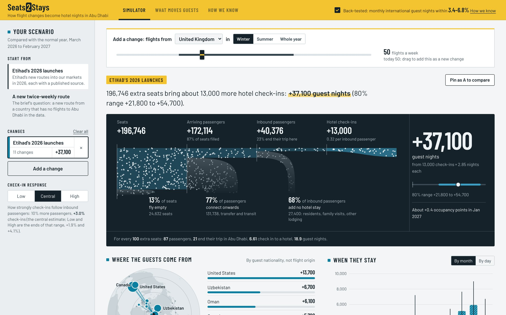
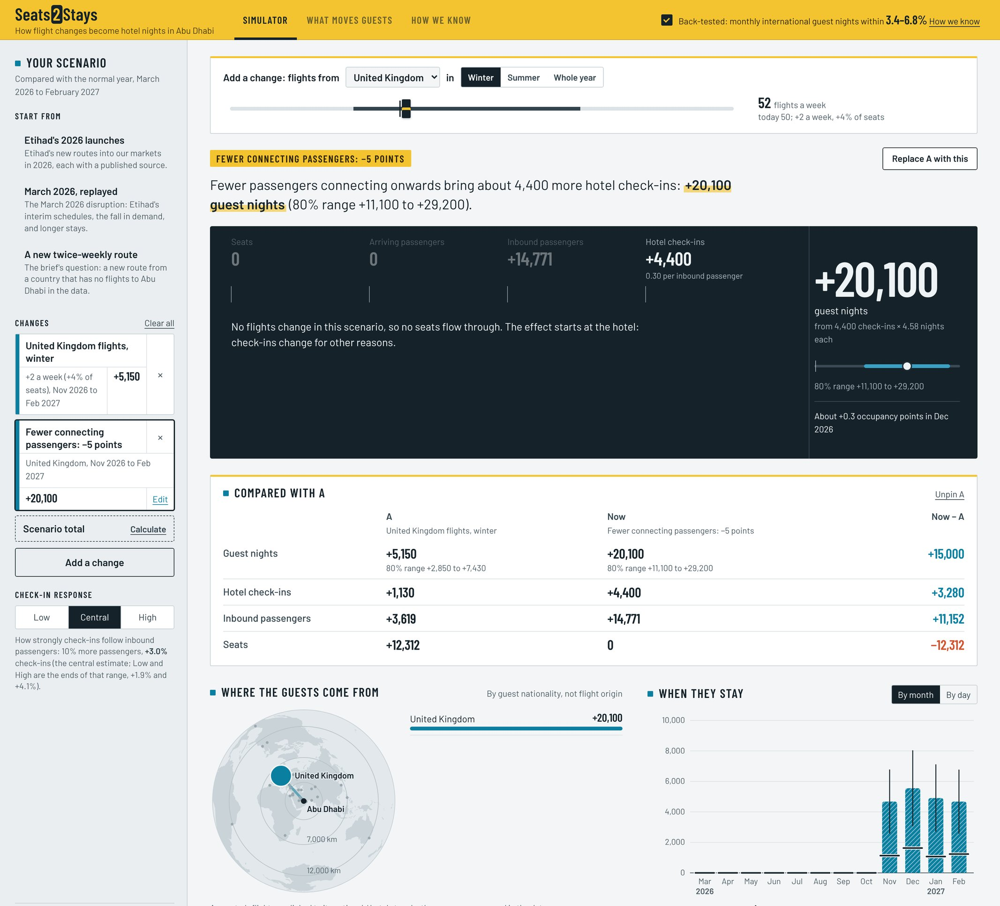
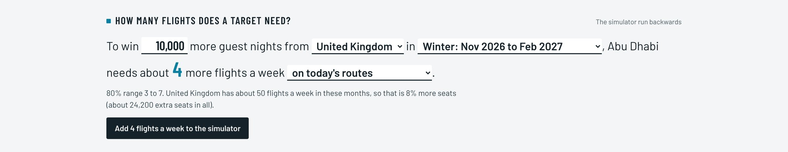
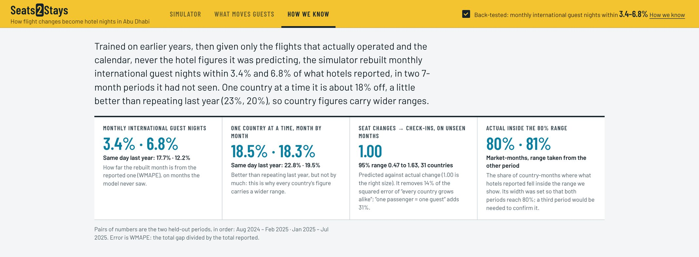

# Seats2Stays

**How flight changes become hotel nights in Abu Dhabi.** A scenario simulator that turns any change in flights (a new route,
more flights a week, bigger or fuller planes, fewer connecting passengers) into extra hotel guest nights, by nationality
and by month, with an honest 80% range. It also runs backwards: give it a target number of guest nights and it tells you
the flights needed.

Built for the **ATRC Advanced Technology Pioneers 2026** challenge, Department of Culture and Tourism (DCT) Abu Dhabi
track: *"How might we build a tool that predicts how flight changes affect hotel visits in Abu Dhabi?"*



> **Data not included.** The competition data is licensed for use within ATP 2026 only. This repository holds the code,
> the method, the tests and the published results. To run it you need the competition data pack (see [Running it](#running-it)).

---

## The problem

Most international visitors reach Abu Dhabi by air, but most passengers never become hotel guests: they connect onwards,
are UAE residents coming home, or stay with family. Flights and hotels are planned with separate numbers, so a simple
question like *"what does one more weekly flight from London bring?"* has no direct answer.

There is also a data catch: the flight data records the country a flight **departed from**, while hotels record the
guest's **nationality**.

## The idea: a seat is not a hotel guest

For every 100 extra seats on Etihad's 2026 launches, the model finds:

```
100 seats → 87 passengers → 21 end their trip in Abu Dhabi → 6.6 hotel check-ins → 18.9 guest nights
```

The obvious shortcut, "one extra passenger means one extra guest", fails. On held-out months it predicted each
country's change in hotel check-ins **worse than ignoring flights altogether**. So instead of applying an average ratio,
Seats2Stays measures how hotel check-ins **actually moved when seats changed**, and builds the simulator on that response.

## How it works

```
Scheduled seats ──load factor──▶ Arriving passengers ──(1 − connecting share)──▶ Inbound passengers
      ──Stage A: response ε──▶ Hotel check-ins ──Stage B: stay model──▶ Guests in-house each night ──▶ Guest nights
```

Every result is the difference between two runs of the same model: a **normal year** (March 2026 to February 2027 on
last year's schedules) and the same year **with your change**. So each answer is what a decision is *worth*.

| Step | Model | Fitted with |
|---|---|---|
| **Seats → inbound passengers** | Load factor and connecting (transfer and transit) share per route, from the passenger data | Measured directly |
| **Stage A: inbound passengers → check-ins** | Year-on-year log changes per country and month, with month fixed effects and two *seat-lead* terms (airlines add seats ahead of demand). Scenario rule: check-ins × (L′/L)^ε | OLS on 505 country-months (33 countries); country-cluster bootstrap, 2,000 resamples |
| **Normal year** | Poisson regression per nationality on daily check-ins: festival window, year-end, Grand Prix and ADIPEC, home-country holidays, school breaks, recent level | Maximum likelihood (statsmodels) |
| **Stage B: check-ins → guest nights** | Discrete-time proportional hazards (complementary log-log), 10 hazard bands over a 45-night window, calendar effects on checkout (Sunday, August, Ramadan, long breaks) | Non-linear least squares (SciPy, trust-region reflective), 589 parameters |
| **New markets** | Countries with no flights borrow the typical response: ε × the median check-ins per seat of countries that fly here (0.048 per seat, 80% range 0.022 to 0.103) | Leave-one-out band |

**The response ε = 0.31** (80% range 0.20 to 0.43): 10% more inbound passengers bring about 3% more check-ins. Without
the seat-lead terms it was 0.44, overstating what flights do. Inside the tested range (the middle 90% of observed
changes, −29% to +109% of inbound passengers) the curve is estimated; beyond it, it is extended in a straight line and flagged.

**The country catch.** A flight from a country is never assumed to carry only that nationality. Each nationality's hotel
check-ins are linked to the seats from its own country, and the measured response already includes other passports on
board and nationals who arrive by other routes. UAE residents are their own group.

## What the simulator does

**1. Simulator.** Presets (Etihad's real 2026 launches, a new twice-weekly route, and more), a live seats slider for any
country and season, and forms to change a route, open a new one, change load factor or connecting share, or change
demand and length of stay. Results by nationality and month, occupancy points, and plain-language notes when a result
is extended or capped. Pin a scenario and compare.



*Two extra UK flights a week this winter add about 5,150 guest nights. Five points fewer UK passengers connecting
onwards add about 20,100, four times as much, without a single extra flight.*

**2. What moves guests.** Sensitivity of guest nights to each lever, guest nights per 1,000 extra seats by country and
month, and a **reverse planner** that solves the engine backwards (Brent's method) for the flights a target needs.



| Lever (1% change) | Change in guest nights |
|---|---|
| Demand not caused by flights | 1.00% |
| Length of stay | 1.00% |
| Share of passengers connecting onwards | −0.44% |
| Seats | 0.19% |
| Load factor | 0.18% |

Seats come out at 0.19 because only the 61% of guest nights from countries with flights respond, at ε = 0.31.
Varying all levers together across their realistic ranges (Sobol, with SALib), demand and length of stay each
explain about 44% of the uncertainty, the connecting share 8.7% and seats 1.6%.

**3. How we know.** Back-tests, the evidence for the country catch, a March 2026 replay, every assumption of the chain,
and the full limitations list.

## Validation

Every model was refitted with data cut at a date and scored on the months after (WMAPE: sum of absolute errors ÷ sum of actuals).

| Measure | Held-out A (Aug 2024 to Feb 2025) | Held-out B (Jan to Jul 2025) | Repeating last year (A / B) |
|---|---|---|---|
| Monthly guest nights, international total | **3.4%** | **6.8%** | 17.7% / 12.2% |
| Monthly guest nights, by nationality | 18.5% | 18.3% | 22.8% / 19.5% |
| Official test window (Aug 2025 to Feb 2026), monthly check-ins | **4.4%** | | 7.7% |

- **The what-if itself is tested.** On the official test window, predicted against actual changes in check-ins across 31
  countries gave a calibration slope of **1.00** (95% interval 0.47 to 1.63). Skill was +0.14 against assuming every
  country changed alike; the one-for-one shortcut scored −0.31.
- **Machine-learning benchmark.** A pre-registered LightGBM model on the same inputs had higher error on the primary
  measure (daily, by nationality) in both held-out periods, clearly in one. It did better on some totals; it cannot run
  a scenario through the chain or give a range, so it is a benchmark, not part of the tool.
- **Ranges.** The 80% ranges contained about 80% of held-out results in both periods. Their width was set on those
  periods, so a fresh period is the real test.
- **Reproducible.** 184 key numbers are snapshotted; a clean rebuild from the raw files reproduces all 184 exactly.
  272 automated tests, including browser tests of the app.



## Limitations

The main ones (the full list is in [docs/TECHNICAL.md](docs/TECHNICAL.md#limitations)):

- **Abu Dhabi airports only.** Guests arriving through Dubai or by road sit inside each country's response.
- **No room supply or prices.** Demand is flagged above the highest level in the data, not capped.
- **The response is estimated from history, not an experiment.** Seat leads and held-out tests get close; a pure
  capacity decision may achieve less.
- **Country-level results are noisy** (about 18% monthly error), so every country result carries a range.
- **Nothing is known beyond seven months** after the data; later months are flagged.
- **Held-out, not blind.** The fitting never used the test periods, but they were looked at while choosing model
  settings. A truly blind test on newer data is the first next step.

## Running it

You need the five files of the ATP 2026 DCT data pack in `data/raw/` (names and checksums in `config.yaml`) and the
public SCAD hotel releases in `data/external/scad/`.

```bash
python3 -m venv .venv && . .venv/bin/activate
pip install -r requirements.txt

make data phase1 phase2 phase3 phase4data   # build tables and fit every model (about 2 hours on 2 cores)
make app                                    # the simulator at http://localhost:8000
make test                                   # the test suite
```

Or with Docker, after the data steps: `docker compose up --build`. The image contains aggregated figures derived from
the competition data, so do not publish it.

Python 3.12 or 3.13. Without the data, the code, its structure and the tests can still be read; tests that need the
data are skipped.

## Repository layout

```
src/atp/        data build, Stage A, Stage B, scenario engine, ranges, sensitivity, simulator, API, validation audit
web/            the front end (vanilla JS + D3, fonts and map vendored so it runs offline)
tests/          unit, integration and browser tests
data/reference/ public reference inputs: holidays, school breaks, festivals, country maps, sourced scenario presets
docs/           technical reference, pre-registrations of the validation audit, images
scripts/        clean rebuild
config.yaml     every path, date, fold and constant
```

Full engineering notes (modules, API, front end, data conventions, the complete limitations list):
**[docs/TECHNICAL.md](docs/TECHNICAL.md)**.

## Stack

Python, pandas, NumPy, statsmodels, SciPy, SALib, LightGBM (benchmark only), FastAPI, D3, Playwright (tests), Docker.

## Team

Built for ATP 2026 (ATRC), DCT Abu Dhabi track, by team Seats2Stays: Mohamed Ibrahim Jaffer, Ahmed AlShehhi,
Syed Uzair and Ilyas Zouaoui.

- **Mathematics, modelling and validation:** Mohamed Ibrahim Jaffer
- **Code:** written with an AI coding assistant (Claude), directed, reviewed and debugged by Mohamed Ibrahim Jaffer
- **Simulator testing, running and Docker set-up:** Syed Uzair
- **Pitch, demo and booth presentation:** the whole team

This is an independent student project; it is not an official DCT Abu Dhabi or ATRC product, and its scenarios
are illustrative.

Code under the [MIT licence](LICENSE). The competition data is not covered and is not included.
